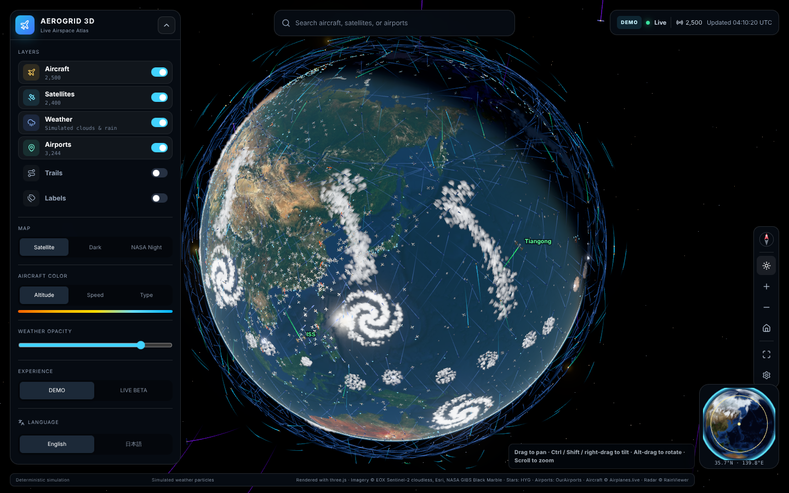

# AeroGrid 3D

An aviation-first live 3D atlas: aircraft are the subject, weather is the context.

AeroGrid has two intentionally separate experiences:

- **Global Demo** — a deterministic worldwide simulation for fluid exploration. It never calls a live aircraft endpoint.
- **Live Beta** — real aircraft within an on-demand radius of 1–250 NM. If live data fails, AeroGrid shows a clear unavailable state instead of inserting demo aircraft.

The public beta is designed for non-commercial, low-cost operation without an SLA. Accounts, alerts, history playback, and infrastructure layers remain outside v1. Optional live sources are configured in Display settings.

## Product behavior

- Custom three.js globe renderer: screen-space-error tile quadtree that loads imagery nearest the screen centre first, polar caps, single-scattering atmosphere, real-time day/night terminator with city lights, specular sun glint, MSAA and bloom.
- Accurate sky: the Sun and Moon are positioned with astronomy-engine, and 8,900 real stars from the HYG catalogue plus a procedural Milky Way rotate with sidereal time.
- Map styles: Sentinel-2 cloudless + Esri satellite imagery, an OpenGridWorks-style dark map with navy oceans, and NASA Black Marble night lights.
- Faceted 3D models for airliners, heavies, light aircraft, helicopters, satellites, Starlink-class craft, and space stations; fast objects leave short light trails.
- Weather is rendered as lit cloud and rain particles: simulated cyclones, fronts and thunderstorms in Demo, RainViewer radar converted to particles in Live Beta.
- 1,150 major and 2,094 regional airports (OurAirports) with zoom-dependent markers and labels.
- Google Earth style navigation: drag to pan, wheel to zoom towards the cursor, Ctrl / Shift / right-drag to tilt, Alt-drag to rotate, double-click to fly in, compass to restore north. The overview mini globe shows where you are looking.
- Display settings with Low / Balanced / High / Ultra presets, MSAA, render resolution, imagery sharpness, bloom, trails, and object limits.
- Collapsible sidebar, top-centred search for aircraft, satellites and airports, fullscreen toggle, English and Japanese UI.
- Live source, coverage, update time, freshness, and failure state are always visible.
- The last successful aircraft snapshot may be shown as `STALE` for at most five minutes. It is then removed.
- Demo satellites remain simulated; Live Beta uses CelesTrak OMM elements with SGP4 predictions and displays the element epoch. Neither is presented as live telemetry.
- Aircraft and satellite trails have independent layer switches; station names respect the Labels switch.
- Cloud volumes stay above the globe at their modelled altitude, including close tilted views. Live cloud heights come from GFS pressure-level forecasts; rainfall comes from RainViewer, with illustrative rain-column heights.
- Optional regional ships and public still-image cameras use Fintraffic. Global receiver-dependent AISStream and paid ADS-B Exchange are selectable with personal API keys; public YouTube videos can be registered at map coordinates.



## Architecture

One Node service exposes the same-origin REST API and serves the Vite production bundle. Keyed providers are accessed only from the server; AISStream uses a server WebSocket. Imagery, radar PNGs, official camera images and owner-enabled YouTube embeds remain browser resources.

```text
Browser -> Node /api/v1 -> 60 s shared aircraft cache -> adsb.lol / selected provider
                    \-> 10 min weather cache --------> RainViewer
                    \-> 30 min cloud profiles -------> Open-Meteo GFS
                    \-> 2 h persistent OMM cache ----> CelesTrak
                    \-> regional ships / cameras ---> Fintraffic
                    \-> private expiring connection -> AISStream / RapidAPI
        -> Node static files -> Vite bundle
```

Public endpoints:

- `GET /api/v1/status`
- `GET /api/v1/flights?lat={-90..90}&lon={-180..180}&radius_nm={1..250}`
- `GET /api/v1/weather`
- `GET /api/v1/clouds?lat={-90..90}&lon={-180..180}&radius_nm={1..250}`
- `GET /api/v1/satellites`
- `GET /api/v1/ships?lat={-90..90}&lon={-180..180}&radius_nm={1..250}`
- `GET /api/v1/cameras`
- `POST /api/v1/connections` / `DELETE /api/v1/connections` — personal one-hour provider sessions; raw keys are never returned

Shared types live in `shared/contracts.ts`, including `AppMode`, `SourceStatus`, and `DataSnapshot<T>`.

## Data sources and limits

| Data | Source | Runtime policy |
| --- | --- | --- |
| Live aircraft | [adsb.lol](https://www.adsb.lol/docs/open-data/api/) (ODbL) or selected provider | Server-only, 250 NM maximum, 60-second cache, 1 upstream request/second, 450-request daily soft limit, stop upstream retries after HTTP 429 |
| Live orbit predictions | [CelesTrak OMM](https://celestrak.org/NORAD/documentation/gp-data-formats.php) | Persistent two-hour cache, stop automatic downloads on failure, no synthetic fallback |
| Cloud profiles | [Open-Meteo GFS](https://open-meteo.com/en/docs/gfs-api) (CC BY 4.0) | Regional nine-point pressure-level forecasts, 30-minute cache, ground-level exclusion |
| Ships / cameras | [Fintraffic](https://www.digitraffic.fi/en/terms-of-service/) (CC BY 4.0) | Finnish receiver coverage; recent vessel reports only, periodic still images |
| Radar | [RainViewer API](https://www.rainviewer.com/api.html) | Server-only metadata, latest documented PNG frame, 10-minute cache, one metadata refresh after tile failure |
| Demo | AeroGrid deterministic generator | Never presented as live data |
| Imagery | [EOX Sentinel-2 cloudless](https://s2maps.eu/) (CC BY-NC-SA 4.0), [Esri World Imagery and Dark Gray Canvas](https://www.esri.com/), [NASA GIBS Black Marble](https://www.earthdata.nasa.gov/gibs) | Browser tile requests, viewport-prioritised, LRU cache |
| Bundled data | NASA Blue Marble, Black Marble and LRO Moon textures; [HYG star catalogue](https://github.com/astronexus/HYG-Database) (CC BY-SA 4.0); [OurAirports](https://ourairports.com/data/) (public domain) | Served from `public/` |

[OpenSky](https://opensky-network.org/about/terms-of-use) is not enabled. Production satellite downloads require `ORBIT_CACHE_PATH` on persistent storage or a `gs://bucket/object` Cloud Storage location; container-local temporary storage is insufficient. Shared Cloud Storage generation preconditions coordinate refreshes across regions and revisions. Any orbital download failure latches a pause for operator investigation under the [CelesTrak usage policy](https://celestrak.org/usage-policy.php).

See [the source research and key setup guide](docs/DATA_SOURCES.md) for coverage, licensing, free versus paid options, and the distinction between forecasts, orbital predictions and observations. AISStream and paid ADS-B Exchange have not been validated with a user's subscribed key.

Provider availability and terms can change. Review the linked terms before every public release. Attribution is displayed in the application.

## Local development

Requires Node.js 22 and npm.

```bash
npm ci
npm run dev
```

Open `http://localhost:3000`. The Vite server proxies `/api` to the Node API on port `4000`. Copy `.env.example` only if you need a different local API port.

## Verification

```bash
npm run lint       # TypeScript
npm test           # unit and API integration tests
npm run test:e2e   # Playwright at 1440x900 and 390x844
npm run build      # client + compiled production server
npm audit
```

`npm run check` runs TypeScript, Vitest, and the full production build. Pull requests run all of the checks above in GitHub Actions, including Playwright.

Release history is maintained in [CHANGELOG.md](CHANGELOG.md). Please report suspected vulnerabilities privately as described in [SECURITY.md](SECURITY.md).

## Production

Build and run the compiled same-origin service:

```bash
npm ci
npm run build
PORT=8080 npm start
```

The multi-stage `Dockerfile` runs as the unprivileged `node` user and health-checks `/api/v1/status`.

`cloudbuild.yaml` publishes to Artifact Registry and deploys Cloud Run in `asia-northeast1` with scale-to-zero and one maximum instance. Before using it:

1. Create the Artifact Registry repository (default substitution: `aerogrid`).
2. Confirm Cloud Build can push images and deploy Cloud Run.
3. Override `_REPOSITORY` or `_SERVICE` if needed.
4. Create the private `$PROJECT_ID-orbit-cache` Cloud Storage bucket with uniform bucket access and public access prevention. The existing runtime service identity needs object read/write access to this bucket; never download service-account keys into the repo. The deployment sets `ORBIT_CACHE_PATH=gs://$PROJECT_ID-orbit-cache/orbits.json`.
5. Review provider terms, daily request metrics, structured JSON logs, and the degraded source state after deployment.

The existing `us-west1` deployment uses a separate Cloud Build trigger. Its ingress container also needs the same `ORBIT_CACHE_PATH`, session affinity and one maximum instance. Updating only this YAML does not change that trigger's configuration. Deployment verification and the active revisions are recorded in [PR #22](https://github.com/lingmulongtai/AeroGrid-3D/pull/22).

Satellite and NASA Night views include bundled Natural Earth coastlines and country boundaries. Lines become clearer on the unlit side, remain faint in daylight, and fade below 400 km camera altitude before city imagery. Source/version/license are in `public/data/earth-boundaries.LICENSE.md`.

## License

[MIT](LICENSE). Third-party data remains subject to each provider's terms and attribution requirements.
